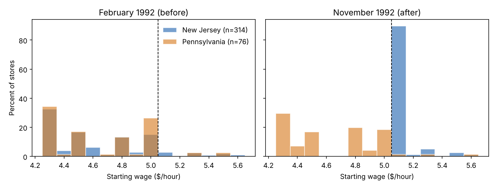

# Minimum Wages and Employment: replicating Card & Krueger (1994)

Course project for Econometrics (Prof. S. B. Paul), March 2026.

This repository replicates the difference-in-differences (DiD) analysis in
David Card and Alan Krueger, "Minimum Wages and Employment: A Case Study of the
Fast-Food Industry in New Jersey and Pennsylvania", *American Economic Review*
84(4), 1994, pp. 772-793.

On April 1, 1992, New Jersey raised its minimum wage from $4.25 to $5.05 an hour.
Neighbouring eastern Pennsylvania stayed at $4.25. Card and Krueger surveyed 410
fast-food restaurants (Burger King, KFC, Roy Rogers, Wendy's) in both states in
February-March 1992 (before) and November-December 1992 (after). Pennsylvania
is the control group for what would have happened in New Jersey without the
increase.

## Headline results

| | Pennsylvania | New Jersey | NJ - PA |
|---|---:|---:|---:|
| FTE employment before | 23.33 (1.35) | 20.44 (0.51) | -2.89 (1.44) |
| FTE employment after | 21.17 (0.94) | 21.03 (0.52) | -0.14 (1.08) |
| Change in mean FTE | -2.17 | +0.59 | **+2.75** |

* **Simple DiD: +2.75 FTE workers per store** (paper: 2.76, SE 1.36, t = 2.03).
  That is about 13% of average New Jersey employment before the increase (20.44).
  Rounding explains the 0.01 gap: the exact difference is 2.754.
* **Balanced sample of stores** observed in both waves: +2.75 (SE 1.34, t = 2.05), identical to the paper.
* **Regression-adjusted DiD** (Table 4), change in FTE on a New Jersey dummy:
  2.33 (1.19), and 2.30 (1.20) with chain and ownership controls. Identical to the paper.
* **Wage-gap (dose-response) design**: GAP = the proportional raise a store needed to reach $5.05.
  Coefficient 15.65 (6.08), 14.92 (6.21) with controls, and 11.98 (7.42) with region dummies
  (paper: 15.65, 14.92, 11.91).
* **Robustness** (Table 5): excluding managers, re-weighting part-timers (0.4 or 0.6), dropping
  shore stores, dropping hard-to-reach stores, weighting by store size and the PA-only placebo
  (-0.30, SE 22.00) all match the paper to within 0.01. Two rows differ
  (see below). No specification produces a negative employment effect.



The wage data show the policy actually bit: 91% of NJ stores paid less than $5.05
before; afterwards 89% paid exactly $5.05, while the PA distribution did not move.

Full tables are in [`output/results.md`](output/results.md) with the paper's numbers alongside ours.

## Method in one paragraph

Full-time-equivalent (FTE) employment = full-time workers + managers + 0.5 x part-time workers.
The DiD estimate is (NJ after - NJ before) - (PA after - PA before). It removes any
fixed difference between the states and any common shock over time (seasonality, the
1992 recession). The key identifying assumption is **parallel trends**: without the
minimum-wage increase, NJ employment would have changed by the same amount as PA's.
The regression version, ΔE<sub>i</sub> = a + b·X<sub>i</sub> + c·NJ<sub>i</sub> + e<sub>i</sub>, uses each store's own change, so
store fixed effects drop out. The GAP version replaces the NJ dummy with
GAP<sub>i</sub> = (5.05 - w<sub>i</sub>)/w<sub>i</sub> for NJ stores below $5.05 (0 otherwise),
which also uses variation *within* New Jersey.

## Repository layout

```
data/public.dat          raw survey data (410 stores), fixed-width ASCII
data/codebook.txt        variable definitions
src/load_data.py         reads the data, builds FTE, GAP, region and chain variables
src/analysis.py          Tables 3, 4 and 5; writes output/*.csv and output/results.md
src/figures.py           starting-wage histograms (paper Figure 1)
output/                  generated tables and figure
```

## How to run

```bash
python -m venv .venv && source .venv/bin/activate
pip install -r requirements.txt
python src/analysis.py     # prints and saves all tables
python src/figures.py      # saves output/fig1_starting_wages.png
```

## Sample and variable choices

* **Table 3** uses every store with employment data in a wave. Six permanently closed
  stores have 0 employment after. The four temporarily closed stores (renovation, road
  construction, mall fire) are missing after, except in row 5 where they are set to 0.
* **Table 4 / Table 5** use the paper's 357-store sample: stores with employment and
  starting-wage data in both waves (permanently closed stores keep their 0 and need
  no wave-2 wage).
* **Controls**: chain dummies (Burger King omitted), company-owned dummy; region dummies
  for central and northern NJ and the two PA areas (southern NJ omitted).
* **Standard errors** in Tables 3-5 are conventional OLS standard errors, as in the paper.
  `output/table4_regressions_hc1.csv` repeats Table 4 with HC1 robust errors, which are
  somewhat larger for the NJ dummy (1.45 vs 1.19).

## Where this replication differs from the paper

These are reported, not hidden:

1. **Table 3, row 3 standard error.** The paper reports 1.36. The paper does not say how it
   handled the covariance between waves when the before and after samples differ.
   Allowing for the within-store covariance gives 1.31 (t = 2.10). The balanced-sample
   row, where no choice is needed, matches exactly (1.34).
2. **Table 4, column (v)**: 11.98 (7.42) vs 11.91 (7.39). Probably a small difference in
   the region coding. Columns (i)-(iv) match exactly.
3. **Table 5, row 2** (temporarily closed stores set to 0): NJ dummy 2.03 vs the paper's
   2.20. The paper's own Table 3 row 5 (NJ change falls from 0.47 to 0.23) implies a
   drop of this size, so we report our number. The GAP coefficient matches (14.42).
4. **Table 5, row 7** (wave-2 interview-week dummies): 2.02 / 14.25 vs 2.27 / 15.79. The
   paper does not define the week boundaries. We use calendar weeks of November 1992
   with December grouped together.
5. **Table 5, rows 3-5, proportional GAP column** differs by 0.1. All level-model columns match.
6. **Table 5, rows 10-11** (towns around Newark and Camden) are not reproducible: the
   public data has no zip codes.

## Data

`data/public.dat` and the codebook come from David Card's data page
(https://davidcard.berkeley.edu/data_sets.html, file `njmin.zip`). They are included
here unchanged for convenience. SHA-256 of `public.dat`:
`04bde0cad5540980f32ce099c6dad369e2f05494698071d8a65b3e1cbe9ca53a`.

## Reference

Card, D., & Krueger, A. B. (1994). Minimum Wages and Employment: A Case Study of the
Fast-Food Industry in New Jersey and Pennsylvania. *American Economic Review*, 84(4), 772-793.
